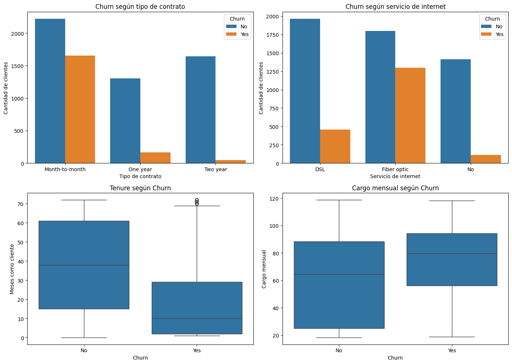
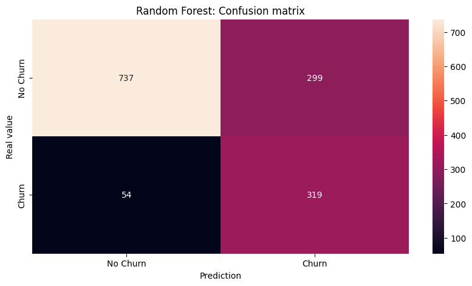
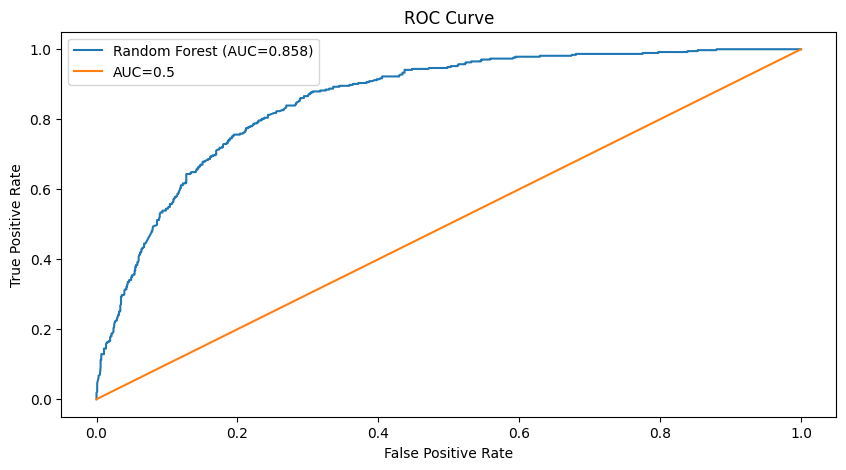

[English](#english) | [Español](#español)

---

## English

# Telecom customer churn prediction

Final project for the Data Science I course at Coderhouse. It is an exploratory analysis plus two classification models that predict whether a customer of a telecom company leaves or stays.

### The problem

A telecom company loses customers every month, and keeping one costs less than winning a new one. The project asks whether a cancellation can be predicted from the customer's contract and services, and which factors are most related to leaving.

### The data

This repo includes the public Telco Customer Churn dataset (`data/WA_Fn-UseC_-Telco-Customer-Churn.csv`): 7,043 customers and 21 columns covering customer details, contracted services, contract type, charges, and the target variable `Churn`. 26.5% of customers left, so the classes are imbalanced. See [`data/README.md`](data/README.md) for the column list and the dataset's original source.

### What I did

1. **Cleaning.** `TotalCharges` came as text. I converted it to numeric and filled the 11 new customers (`tenure = 0`) with 0, since nothing had been billed to them yet. There were no duplicates or other missing values.
2. **Exploratory analysis.** Distributions, boxplots, violin plots, correlations, and how each variable relates to churn.
3. **Preprocessing.** I picked four features: `Contract`, `InternetService`, `tenure`, and `MonthlyCharges`. Categorical variables are one-hot encoded, numeric ones are scaled with `StandardScaler` (fitted on the training set only, to avoid leaking test data), and the split is 80/20.
4. **Models.** Random Forest and Logistic Regression, both with `class_weight="balanced"`. I compared them with recall, precision, and F1, because accuracy is misleading when one class is almost three times larger than the other: a model that always says "stays" is already right 73.5% of the time.

### Findings

- About 43% of customers on a month-to-month contract leave. With a one-year contract it is 11%, and with a two-year contract, 3%.
- About 42% of fiber optic customers leave, against 19% with DSL and 7% with no internet.
- Half of the customers who left did so before month 10. Those who stay have a median tenure of 38 months.
- Customers who leave pay a higher monthly charge on average.



### Results on the test set

| Model | Accuracy | Precision | Recall | F1 |
|---|---|---|---|---|
| Random Forest | 0.749 | 0.516 | 0.855 | 0.644 |
| Logistic Regression | 0.738 | 0.503 | 0.836 | 0.628 |

I chose the Random Forest because it catches slightly more at-risk customers: 319 of the 373 who actually left. The trade-off is that about half of its alerts are false alarms, so a retention action would need to be cheap. The Random Forest AUC is 0.858. The two models give very similar results, which suggests the limit is the four features used rather than the model.





### Limitations

- I used only four features. Services like tech support or online security, or the payment method, could improve the result.
- I tried a single train/test split, so the numbers could change a little with another one.
- I don't have the cost of a retention campaign or the value of each customer, both needed to estimate how much the company would gain.
- The data is a snapshot: it shows relationships, not causes.

### Repo structure

```
telco-churn-prediction/
├── notebooks/
│   └── churn_telecomunicaciones.ipynb
├── data/
│   ├── README.md
│   └── WA_Fn-UseC_-Telco-Customer-Churn.csv
├── images/                # charts used in this README
├── requirements.txt
└── README.md
```

### How to run it

You need Python 3 and the libraries in `requirements.txt` (pandas, numpy, matplotlib, seaborn, and scikit-learn). The notebook itself is written in Spanish.

1. Clone the repo and install the dependencies: `pip install -r requirements.txt`.
2. Open `notebooks/churn_telecomunicaciones.ipynb` and run the cells in order. The CSV is already in `data/`, so no download is needed.

If you run it in Google Colab, upload `data/WA_Fn-UseC_-Telco-Customer-Churn.csv` to the session or to your Drive: the notebook looks for the file in both places too.

### Author

Ignacio Sortino

---

## Español

# Predicción de churn en telecomunicaciones

Entrega final del curso Data Science I de Coderhouse. Es un análisis exploratorio y dos modelos de clasificación para predecir si un cliente de una empresa de telecomunicaciones se da de baja o se queda.

### El problema

Una empresa de telecomunicaciones pierde clientes todos los meses, y retener a uno cuesta menos que conseguir uno nuevo. La pregunta del proyecto es si se puede predecir la baja a partir del contrato y los servicios que tiene el cliente, y qué factores se relacionan más con que se vaya.

### Los datos

Este repo incluye el dataset público Telco Customer Churn (`data/WA_Fn-UseC_-Telco-Customer-Churn.csv`): 7.043 clientes y 21 columnas con datos del cliente, servicios contratados, tipo de contrato, cargos y la variable objetivo `Churn`. El 26,5% de los clientes se dio de baja, así que las clases están desbalanceadas. En [`data/README.md`](data/README.md) está el listado de columnas y la fuente original del dataset.

### Qué hice

1. **Limpieza.** `TotalCharges` venía como texto. La pasé a numérico y rellené con 0 los 11 clientes nuevos (`tenure = 0`) que todavía no tenían nada facturado. No había duplicados ni otros nulos.
2. **Análisis exploratorio.** Distribuciones, boxplots, violines, correlaciones y la relación de cada variable con el churn.
3. **Preprocesamiento.** Elegí cuatro variables: `Contract`, `InternetService`, `tenure` y `MonthlyCharges`. Codifiqué las categóricas con one-hot, escalé las numéricas con `StandardScaler` (ajustado solo con train, para no filtrar datos del test) y dividí 80/20.
4. **Modelos.** Random Forest y Regresión Logística, los dos con `class_weight="balanced"`. Comparé con recall, precision y F1, porque la accuracy engaña cuando una clase pesa tres veces más que la otra: un modelo que siempre diga "no se va" ya acierta el 73,5%.

### Lo que encontré

- Con contrato mensual se va cerca del 43% de los clientes. Con contrato de un año, el 11%, y con uno de dos años, el 3%.
- Con fibra óptica se va cerca del 42%, contra 19% con DSL y 7% sin internet.
- La mitad de los clientes que se fueron lo hizo antes de los 10 meses. Los que se quedan tienen una antigüedad mediana de 38 meses.
- Los que se van pagan, en promedio, un cargo mensual más alto.


### Resultados en el set de prueba

| Modelo | Accuracy | Precision | Recall | F1 |
|---|---|---|---|---|
| Random Forest | 0,749 | 0,516 | 0,855 | 0,644 |
| Regresión Logística | 0,738 | 0,503 | 0,836 | 0,628 |

Elegí el Random Forest porque detecta un poco más de clientes en riesgo: 319 de los 373 que efectivamente se fueron. A cambio, cerca de la mitad de sus alertas son falsas alarmas, así que una acción de retención tendría que ser de bajo costo. El AUC del Random Forest es 0,858. Que dos modelos distintos den resultados tan parecidos sugiere que el límite está en las cuatro variables usadas más que en el modelo.


### Limitaciones

- Solo usé cuatro variables. Servicios como soporte técnico o seguridad online, o el método de pago, podrían mejorar el resultado.
- Probé una sola división train/test, así que los números podrían cambiar un poco con otra.
- No tengo el costo de una campaña de retención ni el valor de cada cliente, que harían falta para estimar cuánto ganaría la empresa.
- Los datos son de un momento puntual: muestran relaciones, no causas.

### Estructura del repo

```
telco-churn-prediction/
├── notebooks/
│   └── churn_telecomunicaciones.ipynb
├── data/
│   ├── README.md
│   └── WA_Fn-UseC_-Telco-Customer-Churn.csv
├── images/                # gráficos que se usan en este README
├── requirements.txt
└── README.md
```

### Cómo correrlo

Necesitás Python 3 y las librerías de `requirements.txt` (pandas, numpy, matplotlib, seaborn y scikit-learn).

1. Cloná el repo e instalá las dependencias: `pip install -r requirements.txt`.
2. Abrí `notebooks/churn_telecomunicaciones.ipynb` y ejecutá las celdas en orden. El CSV ya está en `data/`, no hace falta descargarlo.

Si lo corrés en Google Colab, subí `data/WA_Fn-UseC_-Telco-Customer-Churn.csv` a la sesión o a tu Drive: el notebook también busca el archivo ahí.

### Autor

Ignacio Sortino
